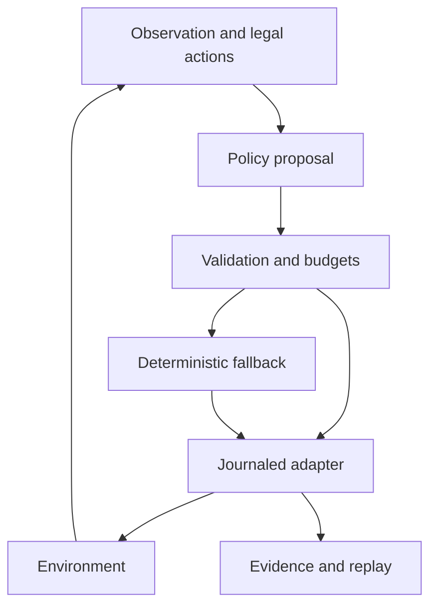

# ARC-AGI-3 — agent infrastructure and evaluation

[](https://github.com/dcw06/ARC-AGI-3/actions/workflows/ci.yml)

An offline agent framework for unfamiliar interactive environments, with isolated client state, journaled actions, bounded inference, deterministic legal fallback, and reproducible experiments. The focus is reliable execution and evaluating which representations help a model interpret its actions and history.

**[Architecture](#architecture) · [Selected results](#selected-results) · [Run CPU checks](#run-cpu-checks) · [Research reports](reports/) · [Development guide](docs/DEVELOPMENT.md)**

## Architecture



The production entry point is `agent/production_main.py`. E1S-R is the **provisional** model-backed configuration, with E0 fallback when model service initialization fails. `agent/my_agent.py` is a compatibility entry point. Offline execution does not imply that an agent solves the benchmark or outperforms other policies.

## Selected results

| Evidence | Observation | What it establishes |
|---|---|---|
| [Evidence comprehension v3](reports/evidence_comprehension_v3_results.md) | 6,054/6,054 questionnaire calls answered; no invalid, truncated, or timed-out calls | Technical completeness of this run |
| v3 legal-coordinate target | Reference 0.859 → assisted interface 1.000 on the synthetic withheld partition | A more usable computed control interface; not unaided rule learning |
| v3 history target | 0.477 → 0.664 with tool assistance | Improvement below the predeclared 0.70 floor |
| [Counterbalanced whole-run experiment](reports/e1_results/e1-whole-run-four-cell-v1.json) | All tested cells/contrasts tied at zero | No gameplay superiority established |

**v3 has completed.** Its result supersedes the old README's planned-run status. Two identical answer passes measure repeatability, not independent samples. Comprehension results use synthetic contexts and do not demonstrate improved live gameplay. The reports preserve technical failures, scope limits, and negative results.

## Run CPU checks

Python 3.12 is required. These selected tests use fake transports and local fixtures; no model, GPU, API key, paid compute, submission, or holdout run is required.

```bash
git clone https://github.com/dcw06/ARC-AGI-3.git
cd ARC-AGI-3
python3.12 -m venv .venv-ci
.venv-ci/bin/python -m pip install -r requirements-ci.txt
.venv-ci/bin/python -m unittest tests.test_phase0 tests.test_phase0_transport_equivalence tests.test_phase0f tests.test_phase1 -v
```

CI runs this bounded suite. It is not full target-runtime or model lifecycle certification. Further development commands and authorization boundaries are in [DEVELOPMENT.md](docs/DEVELOPMENT.md).

## Repository map

| Directory | Purpose |
|---|---|
| `agent/` | Production policies, isolation, execution, state, and fallback |
| `evaluation/`, `config/` | Scoring, contracts, experiment registration, and frozen configuration |
| `tests/` | Unit, transport, lifecycle, and research-specific regressions |
| `reports/`, `evidence/` | Measured results, provenance, and archived run evidence |
| `certification/`, `research/` | Versioned experiment and preparation packages |
| `notebooks/`, `scripts/` | Packaging, diagnostics, replay, and controlled execution tooling |

## Ownership and provenance

Maintained by Chongwei (Alan) Dai. This repository implements the agent infrastructure and evaluation program; the official benchmark/framework and external model weights remain upstream work. Commit authorship and AI coauthor attribution are preserved. See [LICENSE](LICENSE) for this repository's Apache-2.0 license; external artifact permissions are separate.

## Limits and artifact policy

- Model inference and CPU rehearsal are different evidence categories.
- No competitive-performance, H1 pass, or architecture-improvement claim is made by this overview.
- Source changes do not authorize GPU use, external downloads, scored submissions, or holdout execution.
- Frozen evidence and transfer bundles are retained because manifests and replay tooling bind to them. [Artifact guidance](docs/ARTIFACTS.md) explains how to migrate storage without invalidating provenance.
- The [previous README](docs/HISTORICAL_README_2026-10-21.md) is retained as an explicitly historical snapshot, not current operating guidance.
