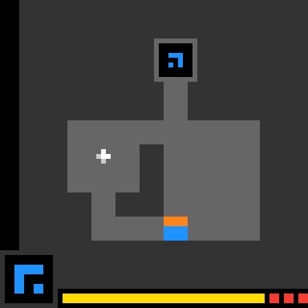
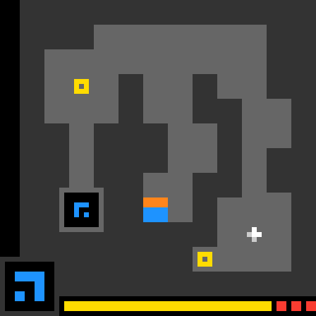

# ls20 object-memory replay

**Level 1 passed; level 2 did not complete; level 3 was not reached.**
This is the retained CPU-r6 run from `caf0b92`: 114 moves, 11 saved encounter
events and two engine-side relocations. Fresh-engine replay matched the run.
No new game play, model inference or GPU job was performed for this export.

## Level 1: passed in 13 moves

The final image in this clip is the new level-2 board shown after completion.

## Level 2: both new rings encountered; level not completed

The controller remembered both ring arrivals, but timer-aware planning remains
unfinished. It stopped at the cross-contact cap after two relocations; there
was no reset request during the episode. Seeing or encountering an object is
not a level pass. This is a deterministic controller with supplied conventions,
not an unaided VLM-solving result.

## Interactive replay and records

- [Download the self-contained interactive replay](index.html?raw=1), then open
  the downloaded HTML in your browser. It includes play/pause, frame selection,
  native mouse coordinates, goals and encounter events. GitHub's file preview
  does not execute interactive HTML.
- [Frame-by-frame action log](actions.md)
- [Structured replay data](replay.json)
- [Saved encounter events](encounters.json)
- [File hashes and source provenance](manifest.json)
- [Results and limitations](../ls20_object_memory_v1_CPU_results_2026-10-22.md)

Images preserve the actual 64x64 board colors, enlarged to 448x448 using exact
7x7 blocks. The export includes the 115 observed frames and their action and
encounter metadata. It excludes private audit, installation, approval, account
and provider-operation records. These published observations are development
data, not an unseen evaluation set.
