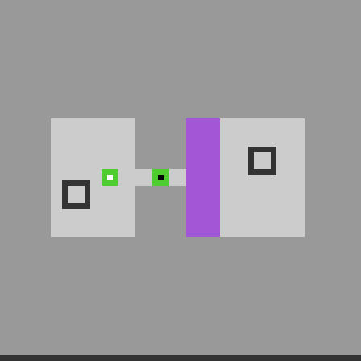

# Does the ls20 agent transfer to ka59?

**The unchanged agent does not yet support ka59.** It stopped before its first
move because it could not find ls20's two glyph panels. In the same test
environment, it completed ls20 level 1 in 13 moves.

This tests the deterministic object-memory/DFS controller from `cbed437`,
not a VLM. Its player recognition, movement model and puzzle rules are supplied
ls20 conventions. We did not change those conventions or add ka59 instructions.

| Game | Purpose | Moves in the study | Level 1 | What happened |
| --- | --- | ---: | --- | --- |
| ls20 | Positive control | 13 | Passed | One cross encounter, then engine-confirmed level advancement |
| ka59 | Transfer candidate | 0 | Not completed | Recognizer refused the unfamiliar glyph-panel layout before planning a move |

## Why ka59?

Its exposed starting board has separate pieces, hollow markers and bounded
regions. Its available actions include `[1, 2, 3, 4, 6]`, making it a reasonable
candidate for testing transfer to another navigation-like game. These visible
similarities do not establish that its movement or puzzle rules match ls20.

The image is the previously published development starting board. The fresh
engine bootstrap matched the retained initial observation exactly.

## Where transfer failed

The diagnostic checked each recognizer independently. The actual controller
stopped at the panel check, which is the first one it needs.

| Existing assumption | ls20 | ka59 |
| --- | --- | --- |
| Orange/blue 5×5 player with ten orange cells | Recognized | `expected ten orange player cells` |
| One specific white-cross pattern | Recognized | `initial white cross must be unique` |
| Two scaled glyph panels with the expected palette | Recognized | `exactly two unambiguous visible glyph panels required` |

**This is a failure to support a new game before gameplay.** It does not show
that ka59 is unsolvable, that a VLM cannot identify its objects, or that encounter
memory and DFS are ineffective once appropriate observations and controls are
available. The agent never reached the stage where those strategies could be
tested on ka59. We did not substitute another policy after the refusal.

## What was verified

Each study episode had a 96-move ceiling, requested one level completion and
started from seed 0. Both outcomes were then reconstructed in fresh engines.
The entire CPU check, including asset verification and cleanup, took **64.4
seconds** within its 300-second limit.

| Check | Result |
| --- | --- |
| Controller unchanged | All 51 existing executed source files match `cbed437` byte for byte |
| Frozen inputs | Both match their earlier retained observations; no masks, hints or action demonstrations supplied |
| Fresh-engine reconstruction | Exact journal and result match for both games |
| Actual directional actions | 26 total: 13 ls20 study + 13 reconstruction; zero ka59 moves |
| Resets and scorecards | Four initial resets and four closed local scorecards across the four episodes |
| Process cleanup | Registered process group exited successfully; no members remained |
| Network | Disabled with a Linux network namespace |
| New model generations / GPU jobs / provider writes | 0 / 0 / 0 |
| Automatic retries | 0; the explicitly counted fresh-engine reconstructions are validation runs |

Fresh-engine reconstruction reruns the same controller. It checks determinism
and retained evidence; it is not a separately implemented policy evaluator.
The source manifest contains 52 files: the unchanged 51-file dependency closure
and the new test harness. A separate read-only audit checked the initial states,
journal continuity, legal actions, counts, source hashes and cleanup receipt.
All earlier attempts remain preserved.

## What should change next?

Keep encounter memory and bounded search, but separate them from ls20's
recognizers and puzzle rules. A new observation/control adapter should identify
candidate pieces without assuming ls20's colors, then measure which pieces move
and by how much from actual before/after observations. Only after that should we
test new-object exploration and navigation on ka59. That adaptation would be a
separate experiment, rather than a claim that the current agent transferred.

## Records

- [CPU test harness](../scripts/check_ls20_transfer_v1.py)
- [Aggregate results](ls20_transfer_ka59_v1_2026-10-24/results.json)
- [Executed source manifest](ls20_transfer_ka59_v1_2026-10-24/source-manifest.json)
- [Retained-evidence audit summary](ls20_transfer_ka59_v1_2026-10-24/audit.json)
- [Earlier ls20 visual replay](ls20_object_memory_v1_replay/README.md)

Raw journals, local process logs and full lifecycle receipts remain local.
The public audit summary binds their relevant hashes without publishing private
filesystem locations or account details.

| Retained binding | SHA256 |
| --- | --- |
| Frozen inputs | `79d2e0698524db21e01270caa311b948820f8185a8451fff9bd941ed87c79a68` |
| Executed source manifest | `162ec84b8824ffd775503a1554dbaf84d1ff2a79f81191fe569fd194302d889a` |
| Comparison | `d72e22b7874b95a5a49551b47bc99219d8cf6c7fdaf958e7596f052fb4edf793` |
| CPU lifecycle receipt | `009511ba623cd8fa0f864ee518fd59ee7b63331cc07d7ff7fcf2f765e32801aa` |
